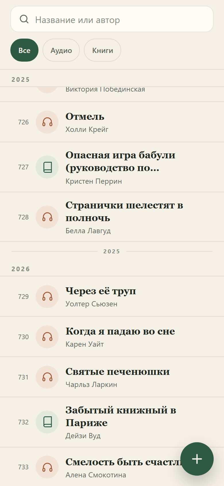

# Прочитано

Личный список прочитанных книг в виде PWA: открыть один раз в Safari на iPhone, добавить на экран «Домой» — дальше список работает офлайн и хранится на телефоне.

**Живой сайт:** [zizaradzr.github.io/books](https://zizaradzr.github.io/books/)


## Что умеет

- **765 книг** из `Книги.docx` уже внутри. Повторные прочтения не удаляются: одна и та же книга может встречаться дважды.
- Номера книг соответствуют docx: от 1 до 765, без пропусков.
- Основной список — хронологический, как в docx. Годы в исходнике — это границы периодов: 2025 открывается на №639 и закрывается на №728, поэтому год стоит в начале и в конце блока. 2018 и 2026 имеют по одной границе.
- Первые 354 книги идут как «До 2018»: точный год в docx не указан.
- Годы выведены для всех книг: 411 с годом, 354 без.
- Поиск по названию и автору: без учёта регистра, `ё = е`, несколько слов ищутся одновременно.
- Фильтр по формату: только «Аудио» и «Книги».
- Сортировка: «По порядку» (docx), «А–Я» или «Новые».
- Добавление, редактирование и удаление книги. Удаление с подтверждением и кнопкой «Отменить».
- Данные не уходят в сеть: только `localStorage` на устройстве, без аккаунтов и сервера.
- **Экспорт в PDF** и резервная копия JSON через меню «⋯».
- PDF открывается через системную печать: на iPhone в диалоге печати выберите «Сохранить в файлы».
- Офлайн-режим через service worker, установка на iPhone, тёмная тема.
- Русский интерфейс, крупные тач-зоны, безопасные отступы под iPhone.

| Конец года и начало следующего | Форма книги |
| --- | --- |
|  |  |

## Запуск

Нужен только Node.js 22+ (для тестов и локального сервера). Сборки и зависимостей нет.

```bash
npm test          # unit-тесты парсинга, поиска, валидации и хранилища
npm run serve     # http://127.0.0.1:8080/
```

Открывать нужно через `http://127.0.0.1:8080/`, а не как файл `file://`: service worker и PWA работают только на `localhost` или HTTPS.

Проверка в настоящем браузере:

```bash
npm run smoke
```

Скрипт запускает headless Chrome, проверяет 765 записей, хронологию, границы годов (2025 дважды), повторные прочтения, поиск, фильтр, добавление, редактирование, удаление, отмену, миграцию старых данных, PDF-печать, перезагрузку и офлайн-режим, а также делает скриншоты в `screenshots/`. Нужен установленный Chrome; при нестандартном пути задайте `CHROME_PATH`. Пример готового PDF — [screenshots/export.pdf](screenshots/export.pdf).

Проверка именно опубликованной версии:

```bash
SMOKE_URL=https://zizaradzr.github.io/books/ npm run smoke
```

В PowerShell:

```powershell
$env:SMOKE_URL='https://zizaradzr.github.io/books/'; npm run smoke
```

## Публикация на GitHub Pages

Сайт уже опубликован: [zizaradzr.github.io/books](https://zizaradzr.github.io/books/). Источник — ветка `main`, папка `/ (root)`. После изменений достаточно `git push`; GitHub Pages пересоберёт сайт автоматически.

Если Pages когда-нибудь отключат: **Settings → Pages → Deploy from a branch → main / (root) → Save**.

Все пути относительные, поэтому сайт работает и в подпапке `/books/`.

### Установка на iPhone

1. Откройте ссылку **в Safari** (не в Chrome и не во встроенном браузере Telegram).
2. Нажмите «Поделиться» → **«На экран „Домой“»** → «Добавить».
3. Запускайте с иконки: приложение откроется без адресной строки и будет работать офлайн.

## Данные

- Ключ хранения: `books:v4` в `localStorage`. Старые `books:v3`, `books:v2` и `books:v1` мигрируют автоматически: форматы упрощаются до «Книга/Аудио», номера добавляются, годы пересчитываются по границам docx, а пропущенные повторные прочтения возвращаются из seed. Старые ключи остаются резервными копиями.
- При первом запуске список из `src/seed.js` записывается в `localStorage`; дальше приложение читает только его.
- Очистка данных сайта в Safari удалит список. Перед этим сделайте **Экспорт в PDF** или **Резервную копию JSON**.
- Импорт заменяет текущий список после подтверждения. Формат — JSON из экспорта.
- Установленное на «Домой» приложение не попадает под семидневную очистку Safari, но бэкап всё равно полезен.

### Обновление списка из docx

Если нужно заново собрать seed из исходного документа:

```bash
python tools/extract_docx.py "C:\Users\user\Desktop\Книги.docx"
node tools/build-seed.mjs
npm test
```

Нужен `python-docx`. Скрипт разбирает строки вида `Название - Автор (аудио книга) 2024 ГОД`, убирает пометки, достаёт год и формат. Дубли не удаляются: каждое повторное прочтение остаётся отдельной записью. Годы определяются по границам: если год встречается дважды, книги между этими номерами получают этот год; одиночная отметка закрывает год (2018) или открывает последний (2026). Уже установленное приложение мигрирует старый `localStorage`; если хотите заново взять seed, очистите данные сайта или импортируйте JSON.

### Обновление самого приложения

После правок в `src/app.js` или `styles.css` поднимите версию кэша в `sw.js`:

```js
const CACHE = "prochitano-v4";
```

Иначе установленное приложение может показать старые файлы из кэша до фонового обновления.

## Структура

```text
index.html            разметка экрана
styles.css            светлая/тёмная тема, iPhone-вёрстка
src/app.js            рендер списка, поиск, формы, меню, PWA-регистрация
src/domain.js         чистые функции: поиск, сортировка, годы, валидация
src/store.js          localStorage, CRUD, миграции, экспорт/импорт
src/parse.js          разбор строк из docx
src/seed.js           сгенерированные 765 записей
sw.js                 офлайн-кэш
manifest.webmanifest  манифест PWA
icons/                иконки 180/192/512 и maskable
tools/                извлечение docx, сборка seed, сервер, иконки, smoke-тест
test/                 unit-тесты
```

## Решения по данным

- Статус только «Прочитано» — по договорённости; отдельного поля статуса нет.
- Поля книги: номер, название, автор, формат, год прочтения. Номер присваивается автоматически (следующий после максимального), год и автор необязательны.
- 528 аудиокниг и 237 обычных книг. Всё, что не помечено в docx как аудиокнига, считается обычной книгой.
- 239 записей без автора: в исходном docx автора не было, их можно дополнить вручную.
- Годы: № 1–354 — «До 2018»; № 355 — 2018; № 356–438 — 2019; № 439–463 — 2020; № 464–484 — 2021; № 485–537 — 2022; № 538–568 — 2023; № 569–638 — 2024; № 639–728 — 2025; № 729–765 — 2026.
- Повторные прочтения сохранены: например, «Гарри Поттер и Философский камень» есть под №354 и №457, «Дары Смерти» — под №368 (2019) и №463 (2020).

## Лицензия

Личный проект; список книг — данные пользователя.
