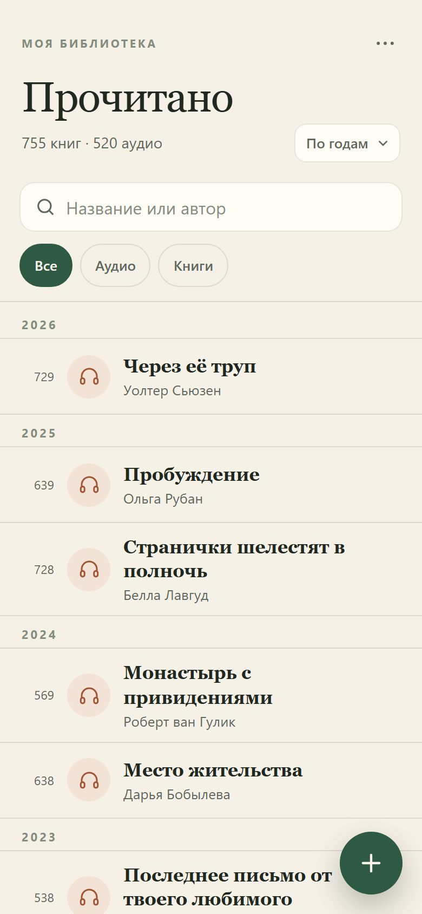

# Прочитано

Личный список прочитанных книг в виде PWA: открыть один раз в Safari на iPhone, добавить на экран «Домой» — дальше список работает офлайн и хранится на телефоне.

**Живой сайт:** [zizaradzr.github.io/books](https://zizaradzr.github.io/books/)



## Что умеет

- **755 книг** из `Книги.docx` уже внутри: 765 исходных строк, 10 дублей удалено.
- Номера книг соответствуют docx: от 1 до 765, номера удалённых дублей отсутствуют.
- Основная группировка — по годам прочтения: 2026 → 2018, затем «Без года». Внутри года книги идут по номерам docx.
- Поиск по названию и автору: без учёта регистра, `ё = е`, несколько слов ищутся одновременно.
- Фильтр по формату: только «Аудио» и «Книги».
- Сортировка: по годам, по алфавиту с группами А–Я или сначала новые.
- Добавление, редактирование и удаление книги. Удаление с подтверждением и кнопкой «Отменить».
- Данные не уходят в сеть: только `localStorage` на устройстве, без аккаунтов и сервера.
- Экспорт и импорт JSON — ручной бэкап через меню «⋯».
- Офлайн-режим через service worker, установка на iPhone, тёмная тема.
- Русский интерфейс, крупные тач-зоны, безопасные отступы под iPhone.

| Форма книги | Тёмная тема |
| --- | --- |
|  |  |

## Запуск

Нужен только Node.js 22+ (для тестов и локального сервера). Сборки и зависимостей нет.

```bash
npm test          # unit-тесты парсинга, поиска, валидации и хранилища
npm run serve     # http://127.0.0.1:8080/
```

Открывать нужно через `http://127.0.0.1:8080/`, а не как файл `file://`: service worker и PWA работают только на `localhost` или HTTPS.

Проверка в настоящем браузере:

```bash
npm run smoke
```

Скрипт запускает headless Chrome, проверяет группы по годам, номера из docx, поиск, фильтр, добавление, редактирование, удаление, отмену, миграцию старых данных, перезагрузку и офлайн-режим, а также делает скриншоты в `screenshots/`. Нужен установленный Chrome; при нестандартном пути задайте `CHROME_PATH`.

Проверка именно опубликованной версии:

```bash
SMOKE_URL=https://zizaradzr.github.io/books/ npm run smoke
```

В PowerShell:

```powershell
$env:SMOKE_URL='https://zizaradzr.github.io/books/'; npm run smoke
```

## Публикация на GitHub Pages

Сайт уже опубликован: [zizaradzr.github.io/books](https://zizaradzr.github.io/books/). Источник — ветка `main`, папка `/ (root)`. После изменений достаточно `git push`; GitHub Pages пересоберёт сайт автоматически.

Если Pages когда-нибудь отключат: **Settings → Pages → Deploy from a branch → main / (root) → Save**.

Все пути относительные, поэтому сайт работает и в подпапке `/books/`.

### Установка на iPhone

1. Откройте ссылку **в Safari** (не в Chrome и не во встроенном браузере Telegram).
2. Нажмите «Поделиться» → **«На экран „Домой“»** → «Добавить».
3. Запускайте с иконки: приложение откроется без адресной строки и будет работать офлайн.

## Данные

- Ключ хранения: `books:v2` в `localStorage`. Старые данные из `books:v1` мигрируют автоматически: формат упрощается до «Книга/Аудио», номера добавляются, сам старый ключ остаётся резервной копией.
- При первом запуске список из `src/seed.js` записывается в `localStorage`; дальше приложение читает только его.
- Очистка данных сайта в Safari удалит список. Перед этим сделайте **Экспорт списка**.
- Импорт заменяет текущий список после подтверждения. Формат — JSON из экспорта.
- Установленное на «Домой» приложение не попадает под семидневную очистку Safari, но бэкап всё равно полезен.

### Обновление списка из docx

Если нужно заново собрать seed из исходного документа:

```bash
python tools/extract_docx.py "C:\Users\user\Desktop\Книги.docx"
node tools/build-seed.mjs
npm test
```

Нужен `python-docx`. Скрипт разбирает строки вида `Название - Автор (аудио книга) 2024 ГОД`, убирает пометки, достаёт год и формат, склеивает дубли. Уже установленное приложение продолжит показывать старый список из `localStorage` — чтобы подхватить новый seed, очистите данные сайта или импортируйте JSON.

### Обновление самого приложения

После правок в `src/app.js` или `styles.css` поднимите версию кэша в `sw.js`:

```js
const CACHE = "prochitano-v3";
```

Иначе установленное приложение может показать старые файлы из кэша до фонового обновления.

## Структура

```text
index.html            разметка экрана
styles.css            светлая/тёмная тема, iPhone-вёрстка
src/app.js            рендер списка, поиск, формы, меню, PWA-регистрация
src/domain.js         чистые функции: поиск, сортировка, группировка, валидация, дубли
src/store.js          localStorage, CRUD, экспорт/импорт
src/parse.js          разбор строк из docx
src/seed.js           сгенерированные 755 книг
sw.js                 офлайн-кэш
manifest.webmanifest  манифест PWA
icons/                иконки 180/192/512 и maskable
tools/                извлечение docx, сборка seed, сервер, иконки, smoke-тест
test/                 unit-тесты
```

## Решения по данным

- Статус только «Прочитано» — по договорённости; отдельного поля статуса нет.
- Поля книги: номер, название, автор, формат, год прочтения. Номер присваивается автоматически (следующий после максимального), год и автор необязательны.
- 520 аудиокниг и 235 обычных книг. Всё, что не помечено в docx как аудиокнига, считается обычной книгой.
- 236 записей без автора: в исходном docx автора не было, их можно дополнить вручную.
- Дубли: удалены точные повторы и длинные названия-повторы без автора. Пара коротких «Маскарад» оставлена, потому что это могут быть разные произведения. Из-за этого 10 номеров docx не используются.

## Лицензия

Личный проект; список книг — данные пользователя.
